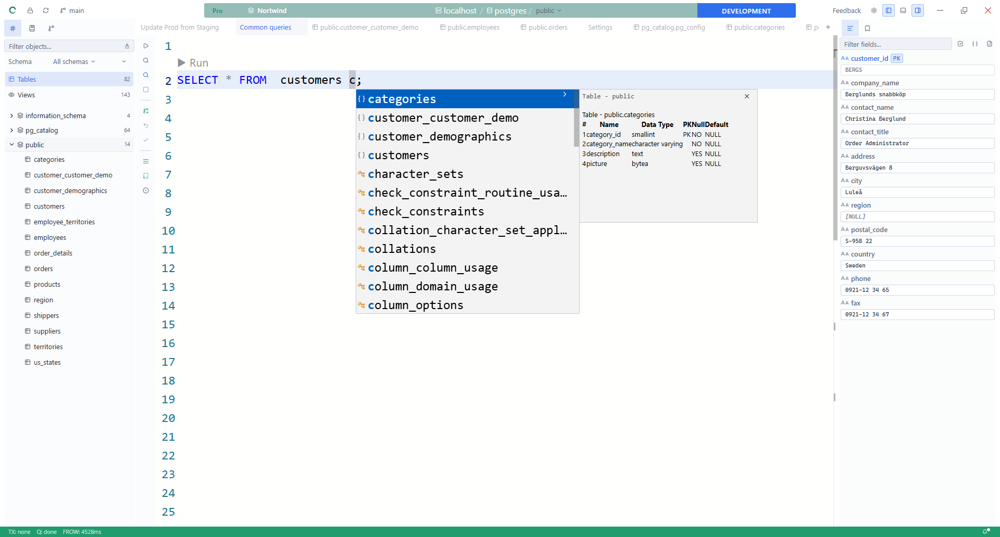
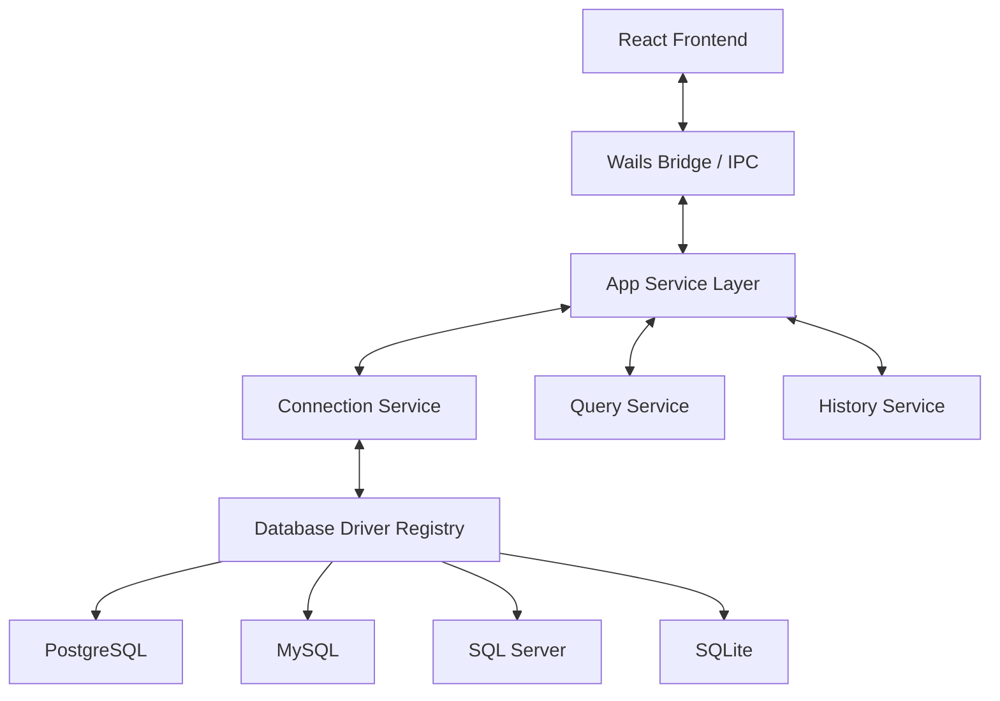

<p align="center">
  
</p>

<h1 align="center">Zentro</h1>

<p align="center">The free, cross-platform SQL IDE for anyone who works with data —<br>developers, analysts, and database operators alike.</p>

<p align="center">
  
  
  
  
  
</p>

Connect to PostgreSQL, MySQL, SQL Server, and SQLite, and get a SQL editor with
autocomplete and inline diagnostics, a schema explorer with ERD, a result grid
with CSV/JSON/SQL export, Git-backed version tracking for your scripts and
schema, and an AI assistant that uses your own model key — all in one
single-binary desktop app, free forever.

## Key Features

- **SQL editor** — autocomplete, inline diagnostics (Error Lens-style), and
  quick fixes for ambiguous or unqualified columns.
- **Schema explorer & ERD** — browse tables, columns, keys, and indexes;
  visualize relationships.
- **Result grid** — paginated results with CSV, JSON, and SQL-insert export.
- **Git-backed tracking** — schema snapshots and saved scripts versioned like
  code, with history and diffs.
- **AI assistant, bring your own key** — free on every plan; connects to the
  model endpoint you configure, never routed through a Zentro-operated
  server.
- **Write-safety guardrails** — preflight checks and an affected-rows preview
  before a destructive statement runs.
- **Multi-database** — PostgreSQL, MySQL, SQL Server, and SQLite out of the
  box. [Don't see your database? Request a provider](#request-a-database-provider).
- **Pro** (optional, 30-day free trial) — unlimited projects, schema
  rollback, query-statistics panel, app lock, secret vault, and PII
  detection.

Built with a Go + Wails backend and a React + TypeScript frontend.

## Screenshots



## Download

Download the latest prebuilt binaries from [zentro-ide.com/downloads](https://zentro-ide.com/downloads).
Prefer a binary built in the open from this exact source? Each [release](https://github.com/ZentroIDE/Zentro/releases)
also carries unsigned Community Edition files (`zentro-ce-*`) built by GitHub Actions in this repository, with
`SHA256SUMS-ce.txt`; the release notes explain the difference.

Current stable release: **v0.10.0** (October 23, 2026).  
See [CHANGELOG.md](CHANGELOG.md) for release notes.

## Request a database provider

Don't see your database above? [Open a feature request](https://github.com/ZentroIDE/Zentro/issues/new?template=feature_request.yml&title=driver%3A%20add%20support%20for%20%3Cdatabase%3E)
naming the database and, if you can, which Go driver it already has a
mature library for — the [driver port](internal/driver/driver.go) is
designed for exactly this kind of addition.

## Zentro Community Edition (CE) vs. Zentro

This repository builds **Zentro Community Edition (CE)**: the free core,
under GPL-3.0-only (see [License](#license)). Building it yourself, as
below, gets you every free-tier feature with no restrictions and no
account. There is no separate name for the official build — "Zentro" on
its own always refers to it.

**Zentro**, the official build from
[zentro-ide.com/downloads](https://zentro-ide.com/downloads), additionally
includes Pro (unlimited projects, stronger write-safety guardrails, schema
rollback, app lock, secret vault, PII detection, query-statistics panel) and
a 30-day Pro trial. Pro's source isn't in this repository (ADR
[0019](docs/adr/0019-open-core-gpl-pro-build.md)) and is licensed
separately — see [COPYRIGHT.md](COPYRIGHT.md).

## Privacy

Building and running Zentro CE from this source never talks to Zentro's
servers, except an update check (`internal/app/update_service.go`), which
you can turn off in Settings. There is no license server call — the app
always runs as Free.

Zentro (the official build) calls the license server to activate a trial,
verify a purchase, and check for updates. The AI assistant, in both
editions, only ever calls the model endpoint you configure yourself (bring
your own key); it is never routed through a Zentro-operated server.

## Running

### Prerequisites

- Go `1.25+`
- Node.js `18+`
- Wails CLI:

```bash
go install github.com/wailsapp/wails/v2/cmd/wails@latest
```

### Development Mode

```bash
wails dev
```

### Production Build

```bash
wails build
```

On Windows, `wails build -nsis` (or `npm run build`, which wraps it) also
produces an installer — requires [NSIS](https://nsis.sourceforge.io/)
(`makensis`) on `PATH`.

## Documentation

For developers working on Zentro:

- **[ARCHITECTURE.md](ARCHITECTURE.md)** — mental model, where things live, design patterns in use.
- **[docs/EXTENDING.md](docs/EXTENDING.md)** — recipes: add a driver, Wails method, event, feature module, UI primitive.
- **[docs/TECH-DEBT.md](docs/TECH-DEBT.md)** — known fat files and refactor candidates.
- **[docs/adr/](docs/adr/)** — Architecture Decision Records.
- **[CONTRIBUTING.md](CONTRIBUTING.md)** — PR process and conventions.
- **[CLAUDE.md](CLAUDE.md)** — dense summary for Claude Code and the canonical source mirrored into the Codex agent setup.
- **[AGENTS.md](AGENTS.md)** — repo instructions for Codex and other agent surfaces.
- Issue tracker: [GitHub Issues](https://github.com/ZentroIDE/Zentro/issues)

## Architecture

Zentro follows a modular service architecture with Ports & Adapters for database drivers and feature-first organization on the frontend. See [ARCHITECTURE.md](ARCHITECTURE.md) for the full mental model.



## Supported Databases

Zentro currently ships with these built-in drivers:

- PostgreSQL
- MySQL
- SQL Server
- SQLite

## Project Structure

- `/cmd`: application entry points
- `/internal/app`: Wails app layer and facades
- `/internal/core`: driver registry and core abstractions
- `/internal/driver`: database-specific implementations
- `/frontend`: React app source
- `/build`: platform build assets (app icon, installer config)

## Feedback

- Bug report or feature request: [open an issue](https://github.com/ZentroIDE/Zentro/issues/new/choose)
- Pull requests are welcome

## Contributing

Please read [CONTRIBUTING.md](CONTRIBUTING.md) before opening a PR.

## License

Zentro's core is licensed under the [GNU General Public License v3.0 only](LICENSE) (`GPL-3.0-only`). Using Zentro, at home or inside a company, places no obligations on you; the GPL applies when you distribute a modified version.

- The official build also includes proprietary Pro features. They are not part of this source tree and are licensed separately.
- Third-party components keep their own licenses: see [THIRD_PARTY_NOTICES.md](THIRD_PARTY_NOTICES.md).
- The Zentro name and logos are not covered by the GPL: see [TRADEMARKS.md](TRADEMARKS.md).
- Contributions require a signed [CLA](CLA.md); see [COPYRIGHT.md](COPYRIGHT.md) for why.
